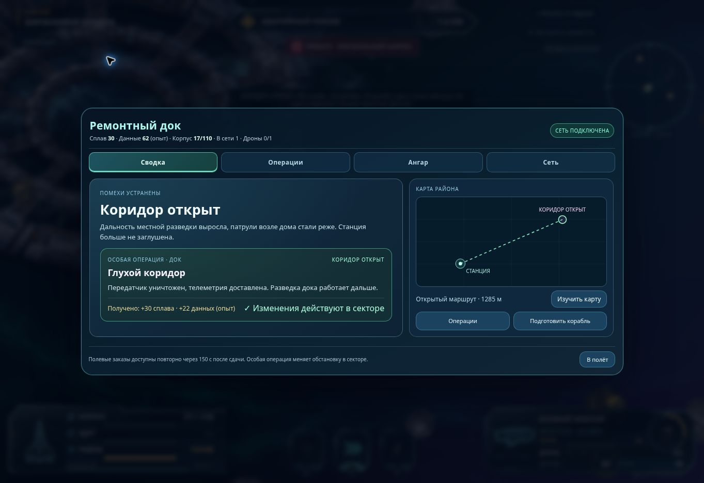
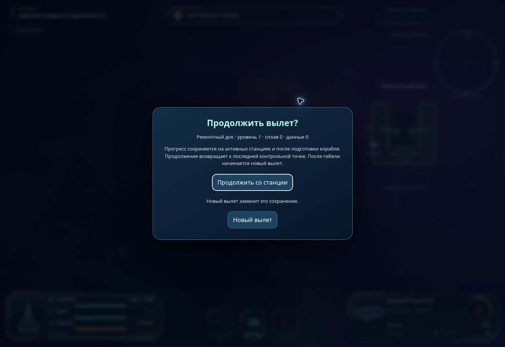

# Возобновление аркадного вылета и первый законченный проход

Дата: 4 ноября 2026 года. Основа: общая сверка 31 исходного пункта и 32 поздних уточнений. Это следующий срез общей задачи, не завершение всего перечня.

## Наблюдение в опубликованной игре до изменения

Обычным управлением пройден путь: подлёт к домашнему доку → бесплатная активация → принятие «Глухого коридора» → получение и установка иона → наём одного дрона → бой у глушителя → отход → возвращение и сдача телеметрии → осмотр следующего выбора в ангаре.

Установленные факты:

- Предварительная установка иона сама по себе не меняет действующее вооружение; «Применить» действительно устанавливает его. Получение модуля автоматически предлагает свободный узел.
- Первый дрон стоит 20 сплава; второй такой дрон на этой станции в начале недоступен. Ведомый участвовал в бою и был потерян.
- Передатчик уничтожен. Игрок вернулся с 17/110 корпуса. Операция выдала 30 сплава и 22 данных; общий итог — 30 сплава и 62 данных. Следующий арсенал отмечен. Прокатный модуль снят и второй раз бесплатно не предлагается.
- Рядом с камнем одновременно показывались «Добыча · E» и старое «F · ДОБЫЧА». Старую подпись убрали; во время расщепления остаётся его прогресс, при выборе цели — одна контекстная подпись.
- В ангаре первая дальнобойная альтернатива всё ещё закрыта уровнем 3. После этого прохождения игрок остался на уровне 1. Это наблюдение одного маршрута, не измерение общей кривой развития.
- По коду глушитель имеет особую границу автоатаки 255 м, в том числе для рельса. Поэтому дальность оружия из ангара не переносится на эту цель полностью. Изменять правило без согласования боя, укрытий и охранения было бы преждевременно.

Оценка проверенного пути — **3/5**: последовательность работает до награды и следующего сигнала; остаются противоречия подсказок и ограничения выбора оснащения. Это оценка одного пути, не готовности игры.

Облачный браузер показывал в полёте примерно 5–40 FPS. Между управляющими командами происходили паузы; это не непрерывная игра человека. Полученный урон, длительность и удобство уклонения не используются для окончательной настройки баланса. Игровой таймер отдельно не зафиксирован; серия 5/15/30 минут и проверка Android не выполнены.

## Правило продолжения

- Контрольная точка создаётся при стыковке с включённой союзной станцией, после совершённых в ней действий и при закрытии её меню.
- При повторном открытии игры доступен явный выбор «Продолжить со станции» или «Новый вылет». До выбора симуляция остановлена.
- Продолжение возвращает весь сохранённый вылет к одной контрольной точке. Прогресс последующей незавершённой вылазки не смешивается с ней.
- Применённая сборка, склад, специализации и очки сохраняются. Неприменённый монтаж остаётся предварительным и в запись не попадает.
- Сохраняются заряды и сроки проката, выданная первая проба, выполненные и отложенные задания, полученные награды, купленные технологии, захваченные станции, маршруты и повреждённые/разобранные камни.
- Сохраняются игровой таймер, противники, ведомые, опасные зоны, снаряды и воздушные группы. Груз, его сопровождение и запись операции после загрузки ссылаются на те же объекты, а не на независимые копии.
- После гибели можно вернуться к последней стыковке. Корабль, ресурсы и весь мир восстанавливаются на момент контрольной точки; все события последней вылазки отменяются. Если контрольной точки нет, доступен новый вылет. Сознательный выбор «Начать заново» завершает прежнее прохождение. Это сохранение внутри одного прохождения, а не перенос развития в новый мир.

Сохранение относится к этому браузеру и адресу игры. Очистка данных сайта или завершение приватного сеанса может удалить его. Проверены [правила localStorage](https://developer.mozilla.org/en-US/docs/Web/API/Window/localStorage), [проверка доступности хранилища](https://developer.mozilla.org/en-US/docs/Web/API/Web_Storage_API/Using_the_Web_Storage_API) и [квоты браузера](https://developer.mozilla.org/en-US/docs/Web/API/Storage_API/Storage_quotas_and_eviction_criteria). Ошибки доступа и записи обрабатываются; игра не выдаёт сообщение об успешном сохранении при ошибке.

## Как запись остаётся согласованной

Две чередующиеся записи содержат версию, порядковый номер и контрольную сумму. Неудачная следующая запись не удаляет предыдущую. При повреждении последней записи берётся предыдущая целая. Более новая неизвестная версия не перезаписывается автоматически.

Состояние хранится как граф обычных данных. Это сохраняет связи между операцией, целью, станцией, противниками и снарядами. DOM, исполняемые функции и изображения не входят в запись; кэш рисования восстанавливается заново. Состояние применяется к игре только после проверки и восстановления мира.

Вторая вкладка с устаревшим вылетом не перезаписывает новые покупки первой. В интерфейсе появляется причина остановки сохранений. Сознательное завершение прохождения записывается как отдельное состояние, поэтому более старая резервная точка не предлагается после выбора нового мира. Обычная гибель сохраняет последнюю стыковку. Возврат не допускается, если другая вкладка успела изменить запись.

Обычные нетронутые камни заново создаются из зерна мира; сохраняются изменённые камни. Для будущих ресурсов мировых событий предусмотрен признак `originKind: 'event'`: новый камень сохраняется и до первого попадания. Сам метеоритный сценарий этим не реализован.

При изменении генерации мира, идентификаторов объектов или обязательных полей нужна миграция либо новая версия формата. Новое долго живущее состояние механики следует явно добавить в `FIELDS` и проверить вместе с её наградой и связями; изображение и производный кэш туда не входят.

## Проверка перед публикацией

Автоматические проверки выполняют настоящие методы игры и проверяют:

1. Корабль, очки, склад, ветви, сеть и изменённые камни восстанавливаются вместе.
2. Транспорт, запись станции, охрана, ракеты и базы авиаудара сохраняют общие ссылки.
3. Повторная сдача восстановленной телеметрии не добавляет награду ещё раз.
4. Прокат не пополняется, первая проба не выдаётся повторно.
5. Ошибка записи, переполнение и слишком большая следующая точка оставляют предыдущую доступной.
6. Повреждённая последняя точка, неизвестная версия, недоступное хранилище и две вкладки обрабатываются отдельно.
7. Гибель и явный новый вылет не открывают продолжение старой резервной точки.
8. Произвольные прототипы, функции и опасные ключи не восстанавливаются.
9. Будущий новый ресурс события не исчезает и не дублируется при восстановлении.

Живая приёмка выполнена в опубликованной версии `5e256d3`: активирован док, принята операция, куплен дрон за 20 сплава, получен и установлен ион. После обычной перезагрузки появился выбор продолжения; восстановились подключённый док, один дрон, нулевой остаток сплава, принятая операция и действующая сборка «плазма + ион». У иона после загрузки показаны те же три заряда. Бесплатная активация и её 20 сплава повторно не предлагались. Проверка завершена повторной перезагрузкой и продолжением.

В этой проверке обнаружено, что первый кадр после продолжения ещё показывал исходное название сектора и ждал вылета для обновления окружения. Последующая поправка восстанавливает сектор, ближайшие камни и станции до открытия дока. Добавлена отдельная проверка этого порядка; общий набор — 398 тестов, включая 15 проверок сохранения и продолжения.

Повторная выдача уже завершённой миссии проверяется настоящим методом игры в автоматическом тесте. Заново проходить весь «Глухой коридор» после добавления сохранений в этом срезе не заявляется. Серия 5/15/30 минут и Android остаются открытыми.

## Что остаётся в общей задаче

Следующий содержательный приоритет — связать ограничения вооружения, поведение дерева и задания. Нельзя считать таблицу ангара доказательством разных тактик. Сначала проверить ограничения целей, метки, ракеты, укрытия и ручные модули на четырёх уже существующих операциях; затем доводить следующий отличный способ действия.

Защита одиночной базы и сети, стазис, налёты противника, семена станций, полный метеоритный сценарий, три глушилки реактора, недостающие состояния «Зрачка», звук и мобильный HUD остаются самостоятельными направлениями общей сверки. Сохранение позволяет продолжать их общий мир, но не заменяет их реализацию.

Подход с проверкой законченного пути соответствует описанию [глубокого игрового прототипа MIT Game Lab](https://gamelab.mit.edu/about/game-development/) и докладу [Play Early, Play Often — Soren Johnson, GDC](https://gdcvault.com/play/1013460/Play-Early-Play-Often-Prototyping). Это основание проверять последствия решений на игре; конкретные числа урона, цены и радиусы всё равно требуют собственной проверки.
