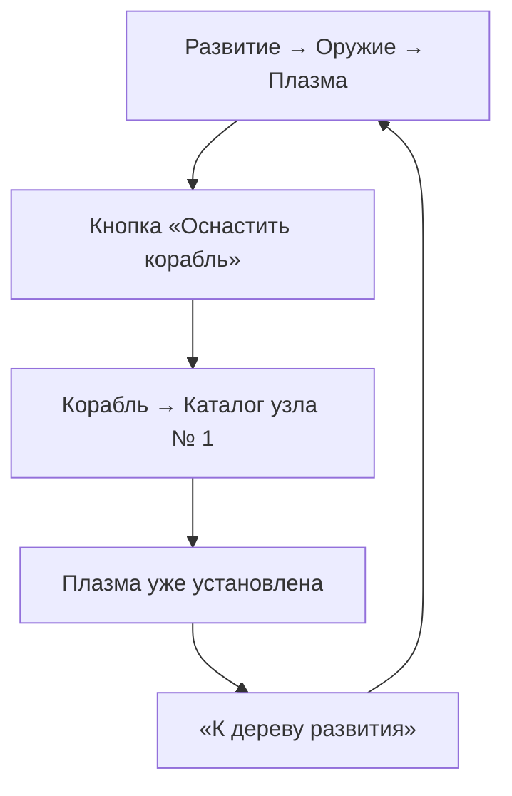
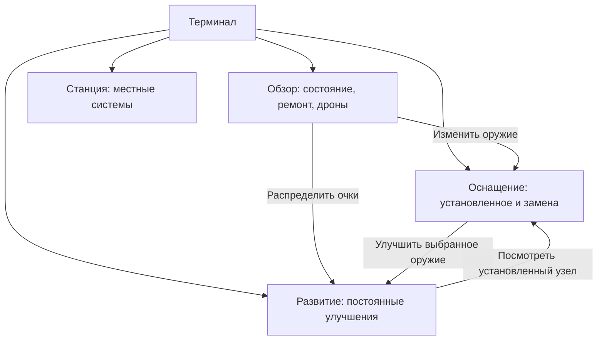
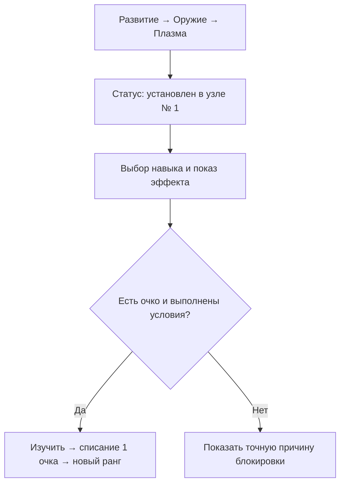
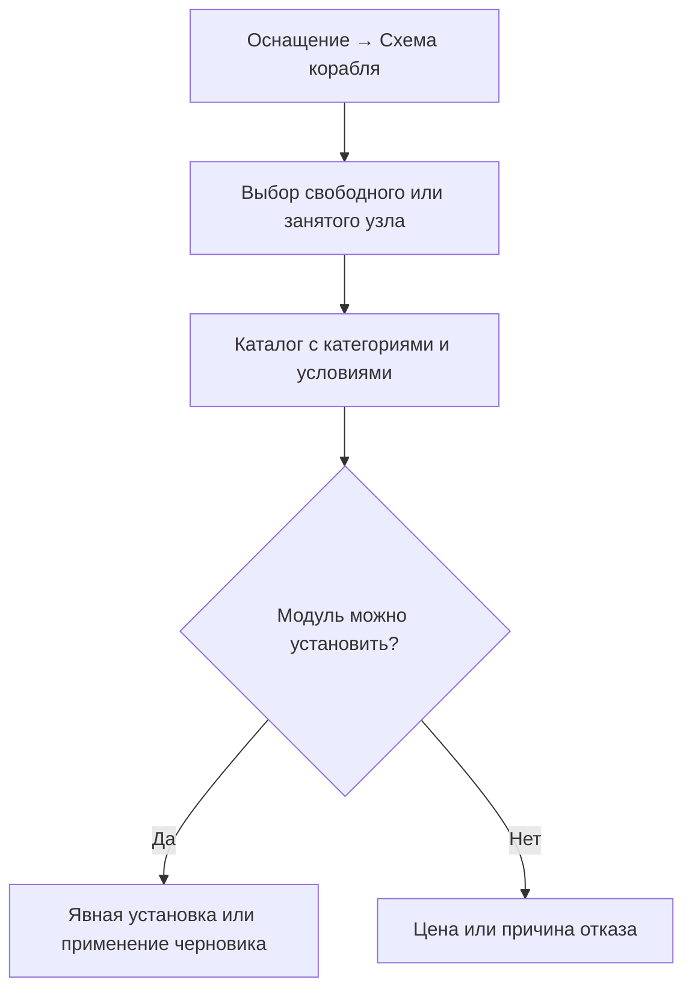

# «Выживший»: логика станционного терминала — текущее состояние и проект V1

**Статус:** проект скорректирован после повторного эргономического аудита. Первая реализация находится в рабочей ветке `codex/menu-architecture-plan-20261109`, ещё не выпущена в `main`.

**Источник истины:** `vesninsergeybk-afk/survival-open`. Исходный аудит проведён на `743e64522afc72332fe0bcada5bfe895b6047556` (09.11.2026); перед изменениями рабочая ветка объединена с обновлённой `main` (`92a6eff`, прототип обучения). Реальные переходы старого интерфейса проверены на исходной версии. При подготовке выпуска заново проверить вершину `main`.

**Границы задачи:** станционный терминал и переходы к карте/полёту/прокачке. Правила боя, цены, сохранения, экономика, открытие уровней, логика турелей и баланс не меняются без отдельного решения. Старый пролог и архивная игра не затрагиваются.

**Исходная проверка:** на указанном коммите `node --test arcade/tests/*.test.mjs` — **1496 тестов пройдено, 0 ошибок**. Это проверка существующей механики, а не доказательство удобства нынешнего меню. Специализированный набор из 60 проверок меню/ангара также прошёл без ошибок.

## 1. Цель и критерий готовности

Игрок должен с первого взгляда различать четыре действия: **проверить состояние**, **купить улучшение**, **установить оборудование**, **выполнить обслуживание**. Он должен видеть, что уже установлено, на что повлияет покупка и сколько она стоит, ещё до расхода очков или сплава.

Критерии будущей реализации:

1. Каждое действие имеет одно основное место в терминале; ссылки в других местах лишь открывают конкретный объект, не создавая второй способ покупки.
2. «Обзор» позволяет отремонтировать корпус, починить дронов и нанять доступного дрона напрямую, без промежуточной вкладки.
3. «Оснащение» показывает действующую сборку корабля, а «Развитие» — постоянные улучшения. Выбранное оружие и его узел узнаваемы в обоих разделах.
4. У навыка до покупки указаны затрагиваемые системы, эффект следующего ранга, стоимость, условия и состояние установки.
5. Контекстный переход возвращает игрока к тому же объекту и выбранному узлу. Нет кнопок с обещанием «установить» для уже установленного оружия.
6. Покупки и сохранённые данные не меняются только от просмотра, навигации и отмены.
7. Проверены клавиатура, мышь, сенсорное управление, узкие экраны и контрольные точки прежних версий.

## 2. Существующее устройство: факт по коду

### 2.1. Главная навигация

| Вкладка | Внутренние разделы | Фактическое назначение |
| --- | --- | --- |
| `summary` — «Обзор» | Следующая цель, карта, ремонт, дроны, очки, полевой пробный модуль | Состояние и переходы к обслуживанию; бесплатная проба открывается здесь; быстрые ремонт и наём обычно требуют перехода |
| `operations` — «Задания» | Полевые заказы, особые операции, награды, региональные планы | Принятие и сдача заданий |
| `hangar` — «Корабль» | `weapons` / `upgrades` / `tactics` / `services` | Установка оружия, сводка корпуса, выбор устройства, ремонт и дроны |
| `development` — «Развитие» | `pilot` / `weapons` / `ship` / `tactics` / `network` | Очки развития, специализации, расширение узлов, местами покупка или установка устройств |
| `network` — «Станция» | Связь, оборона, общая технология флота, модуль станции, маршруты | Локальные действия станции за сплав, некоторые с глобальным эффектом |

Сейчас «Корабль → Корпус и узлы» и «Корабль → Тактика» часто лишь показывают статус и ведут в соответствующее «Развитие». Это **не идентичные операции**, но повторяющиеся названия создают ложное ожидание.

### 2.2. Подтверждённый навигационный цикл



`progression-screen.js:detailHtml()` показывает переход `fitWeapon` даже при `installed=true`. `game.js:focusFittingWeapon()` принудительно открывает каталог, хотя модуль уже стоит в подходящем узле. Обратная кнопка лишь меняет главную вкладку. История возврата `menuTrail` хранит **режимы** окон (`base/map/skills`), но не маршрут между вкладками внутри `base`.

### 2.3. Другие установленные противоречия

| Наблюдение | Проверяемый источник | Следствие |
| --- | --- | --- |
| «Калибровка орудий» показана в дереве плазмы и ряда других пушек | `progression-screen.js:weaponNodes()`; `ship-loadout.js:moduleStats()` | Общее улучшение воспринимается как отдельное улучшение каждой пушки; ранги у него общие |
| «АВТО» содержит ион, резонатор и гаубицу | `progression-screen.js:branchButtons()`; `ship-loadout.js:MODULES` | Ион и резонатор имеют `kind:manual`, гаубица — `kind:heavy`; подпись ошибочна |
| «Развитие → Тактика» предлагает действие экипировки или получения устройства | `progression-screen.js:tacticalNodes()` | Граница между развитием и оснащением нарушена не только внешне |
| «Развитие → Станции» объединяет реальное улучшение вместимости контуров и три ссылки на «Станцию» | `progression-screen.js:networkNodes()` | Игрок ждёт дерево развития, но часть узлов лишь перенаправляет |
| Обзор показывает ремонт и дронов, но основная кнопка — `openShipService` | `base-panel.js:dashboard`; `game.js` | Лишний переход для двух частых действий |
| Действует отдельная логика предварительной сборки и сохранённых схем | `ship-loadout.js:HangarSession`, `quoteLoadout()` | Нельзя упрощать ангар ценой потери черновика и подтверждения применения |

**Конфликт документации:** `docs/MENU_FUNCTION_REGISTRY_2026_11_05.md` утверждает, что прямые `repair` и `hire` уже доступны на главном экране. Действующие `base-panel.js` и `arcade/tests/station-ux-flow.test.mjs` подтверждают противоположное. При разработке ориентироваться на код из актуальной `main`; прежние документы пересмотреть после внедрения.

## 3. Целевая модель: одна задача — одно основное место

Пять верхних вкладок сохраняются: **Обзор / Задания / Оснащение / Развитие / Станция**. Вкладка `hangar` переименовывается для игрока в «Оснащение»; внутренний программный идентификатор пока оставляем прежним, чтобы не затронуть сохранения и обработчики.

| Экран | Главный вопрос игрока | Что разрешено делать |
| --- | --- | --- |
| **Обзор** | «Готов ли я вылетать?» | Проверить состояние, отремонтировать корпус/дронов, нанять дрона, взять местную услугу, увидеть свободные очки и текущую сборку |
| **Задания** | «Какую цель выбрать и где получить награду?» | Принимать, выполнять в полёте и сдавать задания; получать обещанные награды |
| **Оснащение** | «Что сейчас стоит на корабле?» | Выбрать узел, купить/поставить/снять орудие, выбрать полевое или тактическое устройство, сравнить сборки, сохранить/применить схему |
| **Развитие** | «Какие постоянные возможности открою?» | Тратить очки на пилота, оружие, корабль, тактику; за предусмотренные ресурсы открывать постоянные общие возможности, включая узлы и вместимость контуров |
| **Станция** | «Что я могу сделать именно с этой станцией?» | Улучшить локальные системы, выбрать её специализацию, управлять связью/обороной/рейсами/перелётами |

**Разграничение спорных покупок:** открыть новый оружейный узел за сплав — `Развитие → Корабль`; купить очередное оружие в открытый узел — `Оснащение`; улучшить общую вместимость контуров за сплав и флюкс — `Развитие → Сеть`; один раз вложить ресурсы конкретной станции в технологию флота — `Станция`, потому что право на действие закреплено за этой станцией. По этой причине правило «все траты строго в одном разделе» было бы неверным.

### 3.1. Целевая схема действий



«Задания» остаются самостоятельной пятой вкладкой; на схеме показаны только пересекающиеся сейчас области.

### 3.2. Подменю целевого устройства

**Обзор:** одна страница без дополнительного подменю обслуживания. Верхняя полоса показывает `Уровень`, `Свободные очки`, `Сплав`, `Флюкс` (если он уже открыт), `Корпус`; ниже — актуальная цель, быстрые действия и краткая сборка. Кнопка с ценой на карточке совершает действие непосредственно здесь. Кнопки становятся недоступны с конкретной причиной, если средств или условий не хватает.

**Оснащение:** две предметные области — «Оружейные узлы» и «Устройства». Главная часть — схема корабля, узлы и действующее оборудование. Каталог открывается из выбранного узла, а не автоматически по переходу из дерева развития. «Корпус и узлы» как дублирующую вкладку убрать; параметры защиты остаются компактной сводкой в «Обзоре» и в «Развитии → Корабль». «Обслуживание» убрать после переноса всех действий и тестов.

**Развитие:** сохранить пять направлений `Пилот / Оружие / Корабль / Тактика / Сеть` (вместо двусмысленного «Станции»). В «Оружии» сначала «Общие технологии», затем ветки конкретного вооружения; «Комета» и «Мины» — ручное оружие, которое выбирается в полёте и не занимает обычный узел. Ион и резонатор — временные полевые модули с ручным применением и обычным узлом, гаубица — тяжёлый узел `H`. В «Тактике» изучают постоянные ветки, а получают и выбирают активное устройство в «Оснащении». В «Сети» показывают покупаемые постоянные улучшения; информационные узлы связи, обороны и маршрутов переносят в «Станцию».

## 4. Реестр функций: что переносится и кто отвечает

«Основное место» означает одну кнопку, которая выполняет действие. В других разделах допустимы ссылка с точным названием цели и короткая сводка состояния.

| Действие / существующая команда | Сейчас | Основное место в V1 | Ограничение при переносе |
| --- | --- | --- | --- |
| `repair` — платный ремонт корпуса | Корабль → Обслуживание | Обзор → Корпус | Действующие `baseOffer().reasons.repair`, цена и размер восстановления |
| `repairDrones` — ремонт повреждённых дронов | Корабль → Обслуживание | Обзор → Дроны | Показывать только при повреждениях; сохранить проверки стоимости |
| `hire` — найм или замена дрона | Корабль → Обслуживание | Обзор → Дроны | Станционные роли, вместимость, нехватка сплава, замена |
| `service` — аварийная/местная услуга | Корабль → Обслуживание | Обзор → Местные услуги | Не выдавать за постоянное улучшение; применимость зависит от станции |
| `showFieldTrial`, `loanField`, `fieldCharge`, `returnField` | Обзор и обслуживание | Обзор → Полевые модули; установка — Оснащение | Прокат, три заряда, привязка к заданию, возврат, проверка черновика |
| `hgSlot`, `hgFocusWeapon`, `hgEquip`, `hgUnequip` | Корабль → Оружие | Оснащение → Оружейные узлы | Цена, доступность, требование автомата и ионной метки |
| `hgApply`, `hgReset`, `hgSave`, `hgLoad` | Корабль → Оружие | Оснащение → Схемы | Черновик и три локальных шаблона; одна явная операция применения |
| `hgTacticEquip`, `hgTacticUnlock` | Оснащение и частично Развитие | Оснащение → Устройства | Получение за сплав отделить от развития за очки |
| `skill`, `hgUpgrade`, `hgSpec`, `hgTacticUpgrade`, `doctrine` | Развитие | Развитие | Общий счётчик очков, условия уровня, взаимоисключения, пояснения |
| `hgFrame` — новый узел корпуса | Развитие → Корабль | Развитие → Корабль | Сплав; новый слот не равен автоматически полученному оружию |
| `hgNetworkSlots` — вместимость граней контура | Развитие → Станции | Развитие → Сеть | Сплав + флюкс; необходим первый защищённый контур |
| `respec` — смена доктрины | Развитие / станционная услуга | Развитие → Пилот | Сохранить текущую цену и возврат очка; предупредить о последствиях |
| `upgrade`, `antenna`, `installModule`, `confirmModule`, `cancelModule` | Станция | Станция → Местные технологии | Локальная однократность и подтверждение необратимого выбора |
| `toggleMeteorDefense`, `supply`, `transfer` | Станция | Станция → Оборона / снабжение / маршруты | Сохранить связь, ограничения, стоимость, предупреждения |
| `acceptContract`, `claimContract`, операции, первый модуль за заказ | Задания, контекстные кнопки Обзора | Задания; краткая готовая награда — Обзор | Не меняем момент начисления и привязку награды к станции |
| `baseMap`, `baseContours`, `close` | Разные окна | Глобальные кнопки карты/вылета | Открытие карты и прокладка курса не запускают полёт |

**Специально не переносить:** турели, местные технологии станции и оборону контура в «Оснащение корабля»; они не являются вооружением личного корабля. Индикатор флюкса показывать по фактическому открытию механики, без ложного обещания, что им можно оплатить любое улучшение.

## 5. Контракт состояния и маршрутов

### 5.1. Разделить три вида состояния

| Вид состояния | Примеры текущих полей | Правило |
| --- | --- | --- |
| Игровое, сохраняемое | `shipLoadout`, `skillRanks`, `player.points`, `player.ore`, `tactical`, `fieldLoan`, состояние станций | Только действующие команды покупки/установки/награды изменяют его; в первом проходе структуру сохранений не менять |
| Предварительный выбор | `hangarSession.draft`, `hangarSession.slot`, `hangarSession.catalog`, сохранённые схемы | Не исчезает при просмотре других разделов; применение и отмена остаются явными |
| Навигация | `baseTab`, `hangarView`, `developmentDomain`, `developmentWeapon`, `developmentFocus`, выбранное устройство, позиция прокрутки и фокус | Можно менять без изменения игровых ресурсов; при переходе хранить полную исходную позицию |

**Предлагаемый логический маршрут** (это проект контракта, не существующий объект в коде):

```json
{
  "tab": "development",
  "domain": "weapons",
  "weaponId": "plasma",
  "nodeId": "skill-beam",
  "from": {
    "tab": "hangar",
    "view": "weapons",
    "slot": 0,
    "weaponId": "plasma"
  }
}
```

Разработать одну функцию перехода между разделами терминала (условно `navigateDock(route, {rememberSource})`), сохранив существующие `data-act` покупки. Должен существовать **один владелец маршрутизации**; сейчас ветки `openDevelopment`, `focusFittingWeapon`, `baseTab`, `hgView` по отдельности сбрасывают часть выбора. История модальных режимов `menuTrail` остаётся для карты и паузы. Контекстный возврат внутри станции — отдельный короткий маршрут; обычное переключение верхней вкладки не должно без конца наращивать историю.

### 5.2. Правила обратной связи

- Внутри вкладки «Оснащение» кнопка «К схеме» возвращает из каталога к схеме **без потери черновика**.
- Между «Развитием» и «Оснащением» показывать «← К калибровке плазмы» либо «← К узлу № 1», если был контекстный переход. Сохранять выбранный навык, вкладку, фильтр, прокрутку и видимый фокус.
- Кнопка `Оснастить корабль` исчезает, если выбранный модуль уже стоит в узле; вместо неё статус «Установлен в узле № 1» и необязательное «Посмотреть узел».
- Если модуль отсутствует: «Установить в узел № N» только при доступной установке. Если слот занят — «Выбрать, что заменить». Если модуль ещё не получен — прежде всего реальное условие его получения.
- Просмотр не оплачивает и не выбирает специализацию; завершение покупки даёт немедленное сообщение с названием, новым рангом и изменением ресурсов.
- `Escape` не должен неожиданно запускать вылет или терять предварительную сборку. Для возврата к предыдущему контексту — явная кнопка; существующие правила выхода из станции и подтверждения черновика сохранять, пока не проверены отдельно.

### 5.3. Целевой сценарий «Усилить плазму»



Для навыка `beam` обязательно писать **«Общая технология»**. Перед покупкой показать изменение следующего ранга по текущим параметрам: автоматическое оружие и урон ионной цепи, включая будущие установки подходящих модулей. Для специальных навыков подписывать конкретное оружие. Не создавать видимость независимой «Калибровки» в каждой ветке.

### 5.4. Целевой сценарий «Поставить другое оружие»



Проверки установки обязаны пользоваться `quoteLoadout()`/`equipModule()`, а не повторять правила в новом интерфейсе. Нельзя снять последний автоматический ствол, поставить ион без плазмы, разместить гаубицу вне `H` или одновременно использовать конфликтующие полевые модули. Перенос меню не меняет эти ограничения.

### 5.5. Целевой сценарий «Починить и нанять»

На `Обзоре` сразу указать `Корпус 38/110 → 88/110 · 18 сплава` и `Страж 0/1 · 20 сплава` в соответствующем тестовом состоянии. Кнопки `Починить` и `Нанять` вызывают старые команды с их проверками и **после каждой успешной покупки** пересчитывают баланс и доступность другой. Если 20 сплава потрачены на дрона, ремонт становится недоступен с указанием недостающей суммы. Платный и бесплатный способы ремонта объяснить отдельно. Не изобретать «ремонт оружия»: в текущей механике чинятся корпус и повреждённые дроны.

## 6. Обязательные тексты и состояния элементов

| Где | Плохо или недостаточно | Требуемое сообщение |
| --- | --- | --- |
| Дерево, установленная плазма | «Оснастить корабль» | «✓ Установлена · узел № 1»; отдельно «Посмотреть узел» |
| Дерево, отсутствующая пушка | Никакой ясной связи с узлом | «Не установлена. Купите или выберите модуль в „Оснащении“»; ссылка на нужный узел |
| Общая калибровка | «Калибровка орудий» внутри одной пушки | «Общее улучшение: всё автоматическое оружие и ионная цепь»; ранг и следующий эффект |
| Ручные Комета и Мины | Статус «Установлено», хотя обычный слот не нужен | «Доступно в полёте · колесо мыши и ПКМ» (на телефоне — действующие сенсорные действия) |
| Ион или резонатор | «АВТО» | «Полевой модуль · вручную · обычный узел · ограниченные заряды» |
| Гаубица | «АВТО» | «Тяжёлое орудие · узел H · ручное наведение» |
| Свободные очки | Малозаметная строка или карточка внизу | «Свободных очков: N» рядом с ресурсами; если N>0 — «Распределить» |
| Ремонт | «Ремонт и обслуживание →» | «Починить корпус · C сплава · +H прочности» или причина недоступности |
| Дроны | «Обслуживание дронов →» | «Нанять [тип] · C сплава» / «Починить дронов · C сплава» |
| Сборка с изменениями | Неочевидно, что уже применено | «Предварительная сборка» + отдельные «Применить» и «Отменить» |

Точные числа вычислять из живого состояния, а не встраивать в текст. Если навык действует на неустановленное оружие в будущем, показать это явно и не обещать немедленный боевой эффект. Перед покупкой предупредить о необратимых ветках специализаций. Не добавлять подтверждение каждого обычного ранга, если текст уже показывает последствия и цена невелика; подтверждение оставить для реально необратимых решений (например, специализация станции).

## 7. Реализация без нарушения игры

### 7.1. Технический подход

Markdown и Mermaid фиксируют логику; отдельно создан один полноцветный эскиз для сравнения компоновки. Это ориентир, а не подложка игрового интерфейса: цифры, кнопки и состояние должны оставаться настоящими элементами HTML. Для кода важнее таблица владельцев команд, короткий маршрут и проверяемые состояния. Из существующих иллюстраций сохраняем схему корабля, изображения модулей и стиль панелей; дополнительные растровые игровые ассеты потребуются только при выявленном пробеле.

Сохранить действующие функции расчёта и выполнения операций: `baseOffer`, `quoteLoadout`, `moduleStats`, `progressionModel`, `developmentPointLedger`, `HangarSession`, `baseAction`, `hangarAction`, `quoteSpecialization` и `tacticalQuote`. Новые экраны получают данные из этих же источников. Избегать второй реализации проверки стоимости, прав доступа и изменения ранга на стороне верстки.

| Этап | Изменения | Где прежде всего | Проверка перед продолжением |
| --- | --- | --- | --- |
| **0. Контроль состояния** | Зафиксировать новый SHA `main`, выполнить существующие тесты, записать маршруты и состояния | `arcade/tests/*`, игровые сохранения | Есть воспроизводимая исходная точка; не тронуты чужие ветки |
| **1. Честные подписи** | Исправить «АВТО», статус установки, убрать ложную кнопку, показывать общность `beam` | `progression-screen.js`, `hangar-panel.js` | Установленное оружие не ведёт в каталог установки; очки не меняются от просмотра |
| **2. Обзор с действиями** | Прямые `repair`, `repairDrones`, `hire`, локальные услуги, счётчик очков, краткая сборка | `base-panel.js`, существующий `baseAction` | Можно обслужиться в один шаг, цены и причины всегда корректны |
| **3. Разделение оснащения** | Переименовать вкладку, убрать статусные и сервисные дубли, оставить узлы, устройства и схемы | `hangar-panel.js`, `base-panel.js`, CSS | Функции никуда не пропали; доступны все старые сборки и полевые модули |
| **4. Деревья** | Общие технологии отдельно, тактическая покупка/выбор в оснащении, сеть без карточек-переходов | `progression-screen.js`, `tactical-fields.js` | Права на покупку/открытие и список постоянных навыков сохранены |
| **5. Маршруты и возврат** | Централизовать переходы; восстановление объекта, фокуса и прокрутки | `game.js`, состояния экранов | Нет циклов, не теряется черновик; карта и Esc работают по прежним правилам |
| **6. Проверка и выпуск** | Автоматические тесты, реальный браузер, экран 412×915 и 915×412, старые сохранения | `arcade/tests/*`, Pages после PR | Не осталось критичных регрессий; публикация только через `main` и CI |

Этапы с видимыми изменениями выпускаются вместе только после проверки всей цепочки. Нельзя удалить вкладку обслуживания до переноса **каждой** её команды и всех условий.

### 7.2. Контрактные проверки, которые следует написать до больших изменений

| Код | Начальное условие | Действие игрока | Ожидаемый результат |
| --- | --- | --- | --- |
| N01 | Плазма в узле 1, свободные очки >0 | Открыть «Развитие → Оружие → Плазма» | Статус узла 1; нет предложения повторно установить |
| N02 | Один и тот же `beam` показывается для плазмы и рельса | Переключать семейства | Один общий ранг и один счётчик; покупка увеличивает ранг один раз |
| N03 | Рельс не установлен, имеется свободный узел | Перейти к установке | Выбран нужный узел, цена известна; переход не списывает ресурсы |
| N04 | Ион взят напрокат | Открыть дерево и схему | В дереве помечен ручным; в схеме занимает обычный узел; показаны заряды |
| N05 | Один автоматический ствол | Попробовать заменить его одним ионом | Отказ по действующему правилу; ресурсов не потрачено |
| N06 | 20 сплава; корпус 38/110; дронов 0/1 | Починить за 18 | Корпус +50, остаток 2, найм недоступен с указанием нехватки |
| N07 | Те же условия, другое отдельное тестовое состояние | Нанять за 20 | Дрон 1/1, сплав 0, ремонт недоступен с причиной |
| N08 | Повреждены дроны | Открыть обзор и починить | Кнопка ремонта дронов на карточке; корректная стоимость и результат |
| N09 | Нет очков, но оружие установлено | Открыть дерево | Можно просмотреть ветку; кнопка покупки недоступна с причиной |
| N10 | Есть неприменённая схема | Перейти к развитию, карте, вернуться и попытаться вылететь | Схема сохранилась; подтверждение или запрет выхода не пропали |
| N11 | Есть прежнее контрольное сохранение | Загрузить новую версию | Идентичны уровень, очки, навыки, сборка, запасы и временный модуль |
| N12 | Выбран навык плазмы | Перейти в оснащение и обратно | Та же ветка, навык, узел, фокус и разумная позиция прокрутки |
| N13 | Станция неактивна/нет связи/нехватка средств | Попробовать услуги | Нет обхода ограничений через кнопки «Обзора» |
| N14 | Станция готова к вылету | Открыть карту, задать маршрут, закрыть | Корабль не вылетел сам; управление сохраняется |
| N15 | Узкое окно и клавиатура | Tab, Shift+Tab, Esc, верхние вкладки | Доступны все функции, виден фокус, игровое управление не срабатывает в меню |
| N16 | Местная необратимая специализация станции | Запросить установку, отменить | Нет списания и сохранения выбора; подтверждение осталось |

**Примечание к исходному состоянию:** старые тесты ожидали отсутствие `repair`/`repairDrones` в «Обзоре» и четыре внутренние вкладки «Корабля». В рабочей ветке эти проверки уже обновлены под согласованное разделение функций; добавлены отдельные тесты новых сценариев.

## 8. Повторный эргономический аудит и поправки к проекту

**Решение 09.11.2026:** пять главных вкладок остаются. Нового экрана «Общие технологии» не будет: калибровка остаётся единым игровым навыком и обозначается как общая внутри дерева оружия. Узлы «Сеть» не должны имитировать дерево улучшений ссылками на три экрана станции; там остаётся только настоящее улучшение вместимости. В «Оснащении» — только две вкладки «Оружие» и «Устройства». Разделы статуса корпуса и обслуживания устранены из второго уровня.

| Задача игрока | До изменений | В новой логике |
| --- | --- | --- |
| Починить корпус из обзора | Открыть «Корабль», выбрать «Обслуживание», нажать ремонт — 3 нажатия | Сразу нажать ремонт в обзоре — 1 нажатие |
| Нанять доступного дрона | «Корабль» → «Обслуживание» → «Нанять» — 3 | «Нанять» в обзоре — 1 |
| Выбрать другую пушку | «Корабль» → «Оружие» → выбрать узел | «Оснащение» → выбрать узел; при переходе из обзора есть точная ссылка |
| Проверить статус установленной плазмы | Выяснять отдельно через схему корабля | В заголовке ветки указан конкретный узел; «Посмотреть узел» не открывает каталог повторной установки |
| Усилить автоматические пушки | Калибровка внутри разных оружейных деревьев выглядит как независимая | Сохраняется один ранг, но рядом с навыком написано, что он общий |
| Взять местную услугу или прокат | «Корабль» → «Обслуживание» | Раскрыть «Другие услуги станции» в обзоре; повторные кнопки основного обслуживания не показываются |

**Новые состояния интерфейса:** верхняя полоса постоянно показывает свободные очки, а при положительном остатке предлагает открыть развитие; обзор показывает реальные установленные модули; стоимость ремонта и найма вычисляется из текущего состояния; причины недоступности видны рядом с заблокированными действиями.

**Визуальный ориентир:** [эскиз компактного обзора](media/menu-ergonomics-concept-2026-11-09.webp). Это самостоятельный рисунок, не готовый экран игры. Точные надписи, изображения корабля, доступность действий, цены и числа формируются из игровых данных через HTML/CSS. Создавать отдельную картинку для каждого значения интерфейса не требуется.

**Что не меняем:** ветки навыков, их ранги, цены, условия установки оружия, черновики оснащения, сохранения, потоки наград и прав доступа. Реальные обработчики ремонта, найма, полевых модулей и улучшений остаются прежними.

## 9. Риски и меры проверки

| Риск | Мера |
| --- | --- |
| Повторное списание очка или сплава при повторном клике | Старый обработчик остаётся единственным местом изменения; повторная проверка условий перед списанием; тест двойного нажатия |
| Выход из дока с неприменённой сборкой | Сохранить `HangarSession.dirty()` и нынешний бар «Применить / Отменить»; проверить все пути выхода |
| Потеря доступа к прокатному оружию и зарядам | Отдельный инвентарь полевых модулей и явное состояние временного займа; протестировать привязку и возврат |
| Два источника истины для ремонта, набора дронов или вместимости | Только `baseOffer`, `quoteLoadout` и профиль игрока; карточки берут вычисленную цену и причины |
| Искажение экономики станции и контура | Не переносить локальные станционные покупки в общий корабельный магазин; сохранить сплав/флюкс отдельно |
| Сломанные подсказки обучения | После изменения путей обновить обучающие окна и ссылки на вкладки, если обучение будет внедрено параллельно |
| Одновременная работа в других ветках (зум, турели, испытания) | Начинать от актуальной `main` на отдельной ветке; не копировать целиком `game.js` из устаревшей ветки; маленькие коммиты и проверка изменений перед PR |

## 10. Принятые рабочие решения и остающиеся вопросы

**Рекомендуется принять без дополнительных вариантов:** пять верхних вкладок; «Корабль» переименовать в «Оснащение»; ремонт и дроны в «Обзоре»; навыки и сплавные глобальные улучшения — в «Развитии»; установленное оружие имеет чёткий статус; общие технологии не притворяются оружейными специализациями; нельзя скрывать стоимость или последствия покупки; существующие функции расчёта остаются единственными.

**Уточнить при прототипировании:**

1. Название пятого направления «Развития»: «Сеть» (предпочтительно) или «Оборона сети» — зависит от будущих веток турелей и контуров.
2. Как компактно показать все местные услуги на «Обзоре», если станция предлагает несколько разных операций: основное доступное действие и раскрываемый список услуг или несколько карточек.
3. Полевой прокат: после получения автоматически оставаться на «Обзоре» с уведомлением либо, когда требуется ручная установка, открывать конкретный свободный узел. Оба варианта должны исключать скрытое изменение оснащения.

**Следующий шаг:** провести визуальную проверку трёх изменённых экранов (`Обзор`, `Оснащение`, `Развитие → Оружие`) на тестовых игровых состояниях и пройти задачи новичка в настоящем браузере. Этот документ — критерий приёмки, но не замена проверке живой игры.

## 11. Фактическая реализация в рабочей ветке

- Пять верхних разделов сохранены. «Корабль» переименован в «Оснащение»; в нём остались «Оружие» и «Устройства».
- В «Обзоре» доступны прямые команды ремонта корпуса, найма и ремонта дронов; показаны состояние установленного оружия и свободные очки. Редкие местные услуги находятся в сворачиваемом блоке ниже.
- В развитии исправлены классификация оружия и статус установки, помечена общая технология калибровки; устройства получают и устанавливаются в «Оснащении». «Сеть» показывает настоящее улучшение, без трёх карточек-переходов.
- Контекстный возврат между развитием и оснащением сохраняет выбранный навык или оружейный узел. При переходе к уже установленной плазме не открывается каталог повторной установки.
- Действующие команды покупки, размеры расходов, черновики сборок и структура сохранений сохранены. Новые интеграционные проверки проверяют реальные расходы и недоступность услуг после покупки.
- Тестовый сценарий на Chromium сохранён в `arcade/qa/menu-browser-review.mjs`: он делает снимки трёх экранов и двух узких размеров. В текущей среде Chromium не стартует из-за ограничения запуска процесса (`socket(): Operation not permitted`), поэтому визуальная приёмка **не завершена**.
- В `main` изменения меню ещё **не опубликованы**. Перед выпуском проверить новый `main`, реальный размер и читаемость элементов, фокус с клавиатуры и пути игрока по всем трём экранам.
