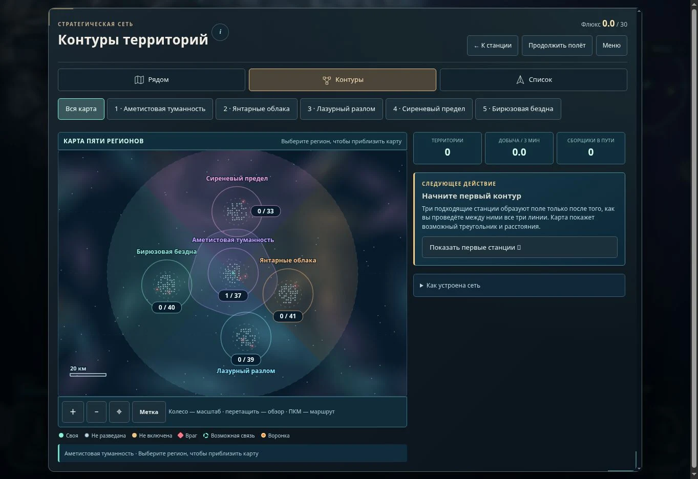
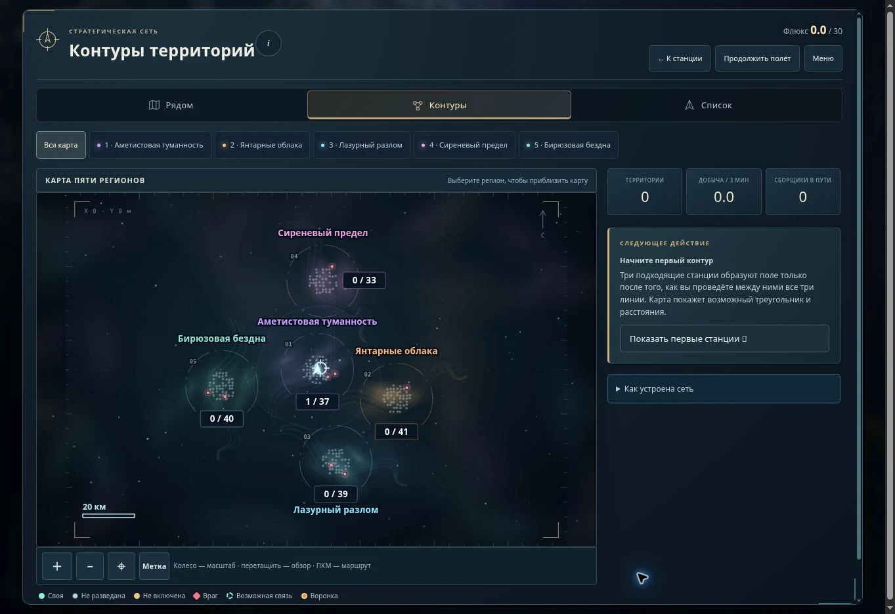
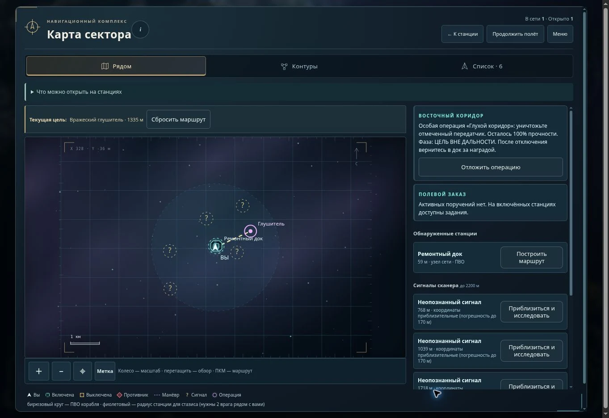
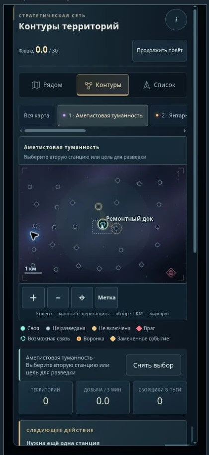
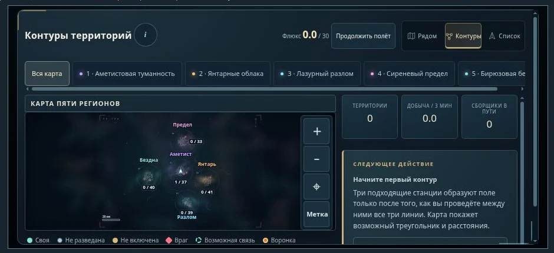

# Художественное оформление карты — 6 ноября 2026

Задача: сделать карту выразительнее и понятнее, сохранив навигацию, разведку и территориальную механику. Изменения подготовлены поверх меню из `3ffd432`, затем совмещены с `d32c645` — прикрытием территории, диверсиями и трофейными технологиями.

## Что взято из игровых примеров

Изучены изображения и описание карты [No Man’s Sky: Beyond](https://www.nomanssky.com/beyond-update/), а также [галактическая карта Stellaris](https://playcraft.space/gallery/stellaris/galaxy-map-outliner/). Второй источник — галерея со снимком, опубликованным издателем; это не руководство разработчика. Выводы ниже — наши наблюдения о композиции.

| Приём | Применение в «Выжившем» |
| --- | --- |
| Пространство заметно тише объектов навигации | Тёмная основа, сдержанные туманности, редкие звёзды; соединения, корабль и выбранные станции ярче |
| Крупные области узнаются по цвету и названию | У пяти регионов свои цветовые акценты; подписи и переключатели согласованы |
| Выбранный объект выделяется отдельно от остальных | Свой корабль — светлая стрелка; у выбранной станции контрастная рамка; действующие связи бирюзовые, путь разведки янтарный |
| Форма дополняет цвет | У разведанных дока, лаборатории, арсенала и авианосца разные пиктограммы; неизвестный узел сохраняет общий нейтральный знак |
| Карта и сведения об объекте разделены | Большая графическая область и более спокойная боковая колонка; текущая цель находится над ближней картой |

Чужие изображения, шрифты и пиктограммы не включены в игру. Оформление создано в SVG и CSS. Декоративные облака привязаны к координатам мира и не изображают станции, границы владения или транспортные связи.

## Изменения

- Общий атлас получил объёмный фон, цветовые облака, редкие звёзды разной яркости, тонкие штрихи по краю, масштаб и указатель севера.
- Приглушена сплошная заливка, из-за которой область карты выглядела большим диском. Сохранена настоящая география регионов.
- Региональные станции и объекты ближней карты используют единые пиктограммы. Названия не перекрывают сам знак.
- На узком экране крупнее главные подписи и символы; внутри общего атласа используются короткие названия, полные остаются в переключателях и доступных названиях кнопок. Второстепенные подписи уступают место выбранной станции и следующей цели.
- В горизонтальном виде заголовок и режимы расположены в одной строке, а кнопки масштаба и метки — в углу графической области. Размер этих кнопок — 44 × 44 px.
- Оформление списка согласовано с картой; цена, последствия и условия существующих действий не менялись.

## Проверка

| Проверка | Результат |
| --- | --- |
| Полный набор игровых тестов после совмещения | **1171/1171**, ошибок и пропусков нет |
| Новые проверки оформления | Детерминированность и ограниченное число фигур, защита сведений о неизвестных станциях, отсутствие перехвата ввода декоративными слоями, прежняя проекция и обновление цепочки модулей |
| Публикационный пакет | Проверено 280 связанных файлов; отсутствующих локальных зависимостей нет |
| Звуковой каталог | 84 события, 46 закреплённых записей Kenney CC0; проверка пройдена |
| Настольный Chromium | Общий атлас, ближняя карта, выбранный маршрут и возврат на станцию; дополнительное визуальное состояние с работающим контуром |
| 360 × 740 | Нейтральные неизвестные узлы, более крупная главная подпись, доступные переключатели и вертикальная прокрутка; горизонтального переполнения диалога нет: 312 / 312 px |
| 412 × 915 | Переход из общего атласа в регион нажатием, выбор своей станции и увеличение масштаба; ширина содержимого равна ширине диалога: 364 / 364 px |
| 915 × 412 | Компактный заголовок; инструменты масштаба видны вместе с картой; ширина содержимого равна ширине диалога: 873 / 873 px |

У карты сохранены исходные координаты, масштаб, создание меток, перемещение и увеличение, переходы между режимами и на станцию, подсказки, список объектов, условия соединений, флюксовый резерв, диверсии и трофейные технологии. Неизвестные станции не получают пиктограмму своего настоящего типа до разведки.

Для насыщенных состояний использован отдельный визуальный стенд: [map-art.html](map-art.html). Он вызывает настоящие функции карты на подготовленном мире и не использует сохранение игрока. Это не отдельный выпуск игры. Игровые обработчики проверены также в самой аркаде и автоматическими сценариями.

Экспертная оценка проверенных сценариев — **4 из 5**. Карта стала цельнее по оформлению, выбранные объекты заметнее. На общем виде телефона мелкие узлы по-прежнему требуют приближения или перехода в регион. Физический Realme, частота кадров на нём и испытание с новыми игроками не проверялись.

## Снимки

До изменений:

Новый общий атлас:

Ближняя карта и текущая цель:

Портретный и горизонтальный размеры:

