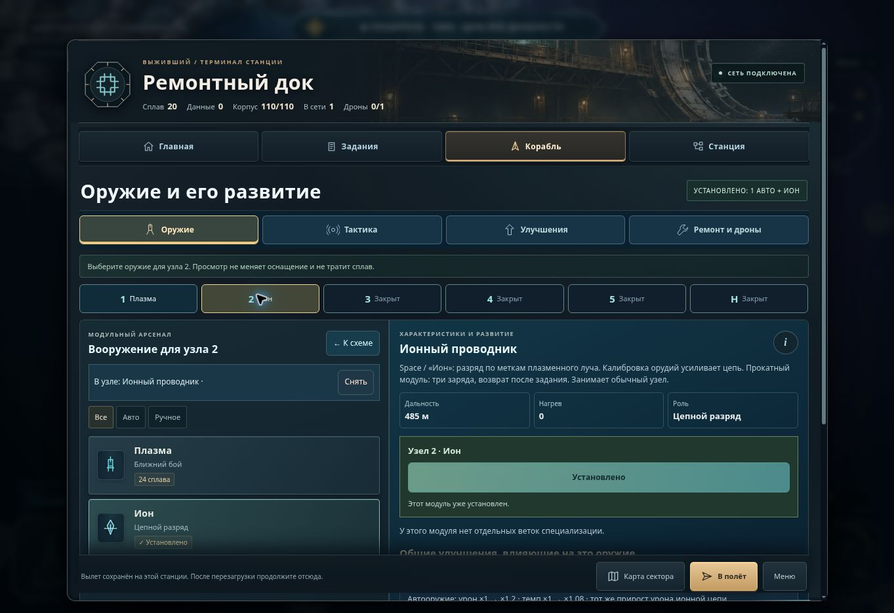

# Проверка меню после сокращения одновременно показанной информации

Изменения выполнены поверх актуального `main`, включая карту с масштабированием, путевыми точками и планом первого контура.

## Что изменено

- В обзоре ангара видны корабль и выбранное оружие. В режиме оснащения остаются каталог и подробности; узлы вынесены в компактную полосу.
- Просмотр оружия не меняет оснащение. Единственная кнопка установки выбранного модуля показывает стоимость; при платной покупке рядом указан остаток сплава. Недостаток сплава не превращает цену в «бесплатно».
- Четыре тактических устройства доступны для просмотра, но описание, цена и две ветки показываются только для выбранного. Просмотр и установка имеют разные действия.
- Улучшения сначала показывают доступные покупки и ближайшее открытие. Полный список технологий и развитие корпуса раскрываются отдельно.
- На станции последовательно показаны связь и территория, развитие, оборона, специализация и перелёты. Радиосвязь услуг явно отделена от линий территориального контура.
- Переход к контурам открывает район текущей станции; при выборе региона подходящая действующая станция выбирается для подсказки. Автоматический выбор не строит линии.
- Навигационный раздел «Цели» переименован в «Список». «Пробное оружие» на главной станции заменено на «Полевой модуль · бесплатно».
- Пиктограммы используют единый набор линий. Существующая система пояснений работает с мышью и клавиатурой; `i` закрепляет пояснение по нажатию, повторное нажатие закрывает его.

## Наблюдения в браузере

Проверена сама игра в обычной ширине и внутри окон 412 × 915 и 915 × 412. Это проверка браузерной компоновки, а не испытание на физическом Realme.

| Сценарий | Результат |
| --- | --- |
| Найти особую операцию | На вкладке «Задания» сразу видны операция, награда и принятие; принятие проверено |
| Найти развитие плазмы | Выбор оружия показывает обе ветки, условия и относящиеся к нему общие улучшения |
| Выбрать оружие для узла | Просмотр сохраняет ресурсы; установка полевого модуля подтверждена по составу корабля и неизменному сплаву |
| Понять следующий шаг к контуру | Экран станции открывает соответствующий район, действующий док и подсказку; план треугольника и новые инструменты карты сохранены |
| Использовать пояснение без наведения | `i` открывает и закрывает пояснение нажатием; покупку при этом не вызывает |
| Горизонтальная компоновка | Каталог занимает две области; устранено прежнее правило, которое складывало его в одну колонку при малой высоте |

На ширине 412 px у проверенного экрана тактики `scrollWidth` совпадает с шириной содержимого. В горизонтальном окне 915 × 412 каталог имеет две колонки без горизонтальной прокрутки.

Экспертная оценка проверенных сценариев: **4/5**. Основные действия и условия теперь различимы, но длинные ветки оружия на узком экране по-прежнему требуют вертикальной прокрутки. Испытание с начинающими игроками не проводилось.

## Автоматические проверки

- `node --test arcade/tests/*.test.mjs`: **1120 / 1120**.
- `node audio-lab/smoke-test.mjs`: успешно.
- Подготовка 46 закреплённых записей Kenney CC0: успешно.
- `node tools/verify-pages-bundle.mjs _site`: 257 связанных файлов, недостающих зависимостей нет.
- `git diff --check`: успешно.

Добавлены проверки реального списания сплава, недостаточного баланса, сохранения загруженной схемы, выбора тактического устройства, ближайшего улучшения, безопасной подсказки контура и пояснений на сенсорном вводе. Существующие проверки подтверждения необратимой специализации станции, сохранений, миссий и паузы входят в общий набор.

