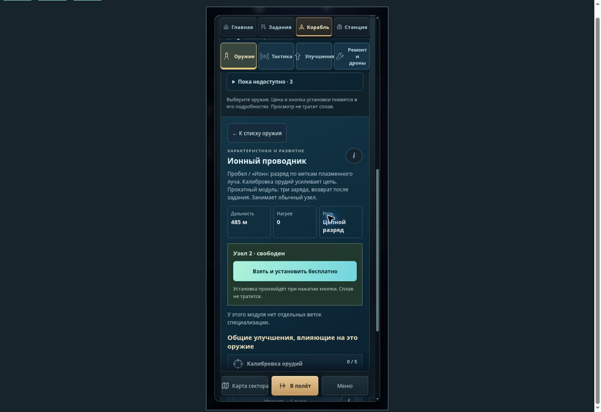
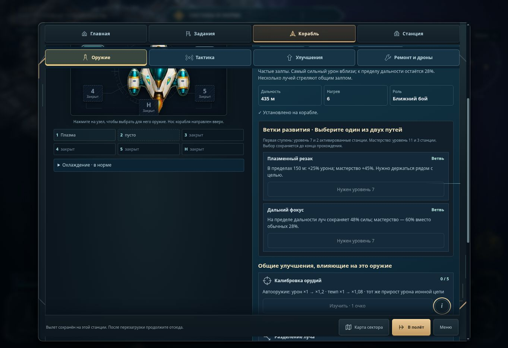

# Повторная проверка меню — 6 ноября 2026

Проверен актуальный `main`, включая оформление станций из `1e1d5d4` и флюксовый резерв. Исходные ошибки воспроизводились до исправлений. Девять новых регрессионных проверок сначала завершались ошибкой, после исправлений проходят.

## Найдено и исправлено

| Наблюдение | Изменение |
| --- | --- |
| Tab переводил фокус на кнопку за нижней границей окна | Диалог прокручивается к выбранной кнопке с учётом закреплённых вкладок и нижних действий |
| Tab попадал в содержимое закрытых раскрывающихся блоков и на вкладки с `tabindex=-1` | Эти элементы исключены из последовательности Tab; заголовки раскрытия доступны |
| Недопустимая загруженная схема сообщала о бесплатной замене | Показаны причина запрета и недоступная кнопка применения; при нехватке сплава указан дефицит |
| Ветки развития описывались как действующие «до конца вылета» | Указано «до конца прохождения»: стыковка и следующий вылет выбор не сбрасывают |
| Описание ручного оружия и охлаждения показывало клавиши по умолчанию после переназначения | Используются действующие назначения, в том числе в пояснениях `i` |
| На узком экране из подробностей оружия приходилось долго прокручивать назад | Добавлена кнопка «К списку оружия» с сохранением выбора и предварительной схемы |
| Подсказки предлагали включить уже работающую, подавленную или вражескую станцию | Следующее действие зависит от известного состояния узла; скрытая принадлежность не раскрывается |
| При ширине 360 px индикатор сети налезал на название дока | Индикатор перенесён ниже названия |

Подавление проверено по `strategic-command.js`: передатчик восстанавливается по игровому таймеру, уничтожение носителя предотвращает повторный импульс. Подсказка не обещает немедленного восстановления после уничтожения корабля и напоминает об остановке времени в меню.

## Проверка результата

- **1138/1138**: `node --test arcade/tests/*.test.mjs` после совмещения с актуальным `main`.
- Каталог звуков: 84 события, 46 закреплённых записей Kenney CC0; проверка пройдена.
- Готовый пакет Pages: 272 файла с зависимостями проверены; отсутствующих локальных ресурсов нет.
- Chromium, окно 1363 × 936: Tab с последнего переключателя оружия переводит фокус на информацию об улучшении и прокручивает её в видимую область. До исправления кнопка находилась на высоте 1146–1182 px; после — 805–841 px. Закрытые разделы пропускаются.
- Размеры области игры 412 × 915, 360 × 740 и 915 × 412 проверены через страницы с ограниченной шириной. В проверенных разделах горизонтального переполнения нет.
- На узком экране проверены каталог, цена и причина запрета покупки, открытие пояснения нажатием, тактика, ближайшее улучшение, возврат к выбранному оружию. Сплав при просмотре остаётся прежним.
- Проверены переход «Станция → Контуры → Станция», автоматически выбранный свой узел, следующий кандидат и план первого контура; задания доступны в отдельной вкладке.

Экспертная оценка проверенных сценариев: **4 из 5**. Это проверка поведения интерфейса, а не испытание с начинающими игроками. Физический Realme и сенсорные жесты на устройстве не проверялись; узкие размеры и открытие пояснений без наведения проверены в Chromium. Условие готовности этого прохода — устранить воспроизведённые ошибки, сохранить игровые ограничения и пройти штатный выпуск Pages.
