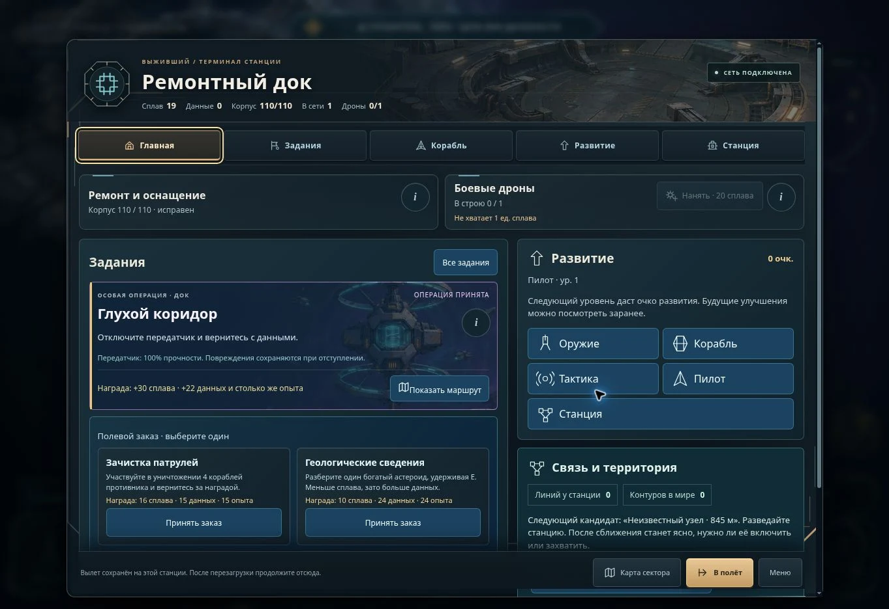
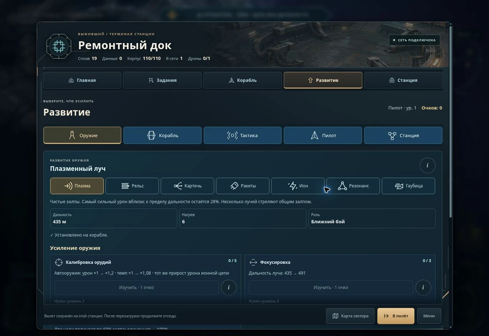

# Пересборка станционного меню — 6 ноября 2026

Исходная версия: `main` на `a4e6796e4412b625388d9a9225010175c2177093`, включая промышленные вылеты за флюкс. Задача — сохранить игровые возможности и дать игроку короткие, предсказуемые пути к ним. Изменения относятся к действующей аркаде `arcade/`.

## Что изменилось

- Главная предлагает сами действия: принять операцию или заказ, забрать награду, выбрать первое бесплатное оружие, починить корабль и нанять дрона. Принятие операции не переносит игрока на другую страницу.
- Пять постоянных вкладок: «Главная», «Задания», «Корабль», «Развитие», «Станция». Карта и вылет остаются в нижней полосе.
- «Развитие» объединяет оружие, системы корабля, тактику, пилота и станцию. Ссылки с главной открывают нужную категорию сразу. Из оружейного инспектора открывается развитие именно выбранного модуля.
- Оснащение и усиление разделены. В каталоге видны цена и отдельная кнопка установки; у недоступного оружия цена остаётся видна. В режиме выбора узла вместо большой схемы показана компактная полоса.
- Тактика показывает четыре компактных переключателя и подробности одного устройства. У систем корабля и пилота сначала видны доступные действия и ближайшее открытие; полный перечень раскрывается по желанию.
- Страница станции начинается со связи и территории. Улучшения и специализация имеют прямой переход в «Развитие»; оборона и перелёты остаются самостоятельными блоками.
- Карта предлагает следующий шаг от выбранной своей станции сразу. Убрана повторная кнопка одного маршрута. Навигационный режим называется «Список».
- Корневые и внутренние вкладки работают со стрелками, Home и End; вкладки без выбора не добавляют лишних остановок Tab. Переключение категорий запоминает их прокрутку и раскрытые подробности.

## Проверено

| Проверка | Результат |
| --- | --- |
| Полный набор `node --test arcade/tests/*.test.mjs` | 1156 пройдено, 0 ошибок, 0 пропусков |
| Новые сценарии `menu-rebuild.test.mjs` | 11: реальные обработчики принятия, награды, очков, уровня, цены, черновика и смены доктрины |
| Старые игровые ограничения | Покупка, прокат, уровни, тип узла, очки, сохранённые схемы, выход с черновиком, подтверждение специализации и пауза проходят в общем наборе |
| `node audio-lab/smoke-test.mjs` | 84 события, 46 записей Kenney CC0; пройдено |
| Установка закреплённых записей в пакет | 46 файлов, 1 817 122 байта; пройдено |
| `node tools/verify-pages-bundle.mjs _site` | 275 связанных файлов проверены; отсутствующих локальных зависимостей нет |
| Chromium, настольное окно | Принятие «Глухого коридора» с главной; ремонт 109 → 110 за 1 сплава; прямой переход в развитие; все пять категорий; стрелки, Home/End; возврат с карты |
| Область игры 412 × 915 | Главная и развитие оружия; пояснение открывается нажатием `i`; ширина диалога и его содержимого совпадает — 364 px |
| Область игры 360 × 740 | Выбор пустого узла, каталог, цена и причина запрета, выбор иона, отдельная бесплатная установка; баланс 19 сплава не изменился; ширина содержимого равна ширине диалога — 312 px |
| Контуры | Свой док выбран при входе; видны кандидат для разведки, 1/3 станций, 0/3 линий и единственная кнопка следующего маршрута |

Старые структурные проверки обновлены под пять вкладок и разделение оснащения и развития. Проверки реальных транзакций сохранены. Дополнительно проверены цена заблокированного рельса и возврат к оружейной странице из подтверждения выхода, даже если до этого было открыто обслуживание.

## Оценка и границы проверки

Экспертная оценка проверенных сценариев — **4 из 5**. Теперь игрок выполняет частые действия на главной и видит все направления развития в одном месте. На узком экране длинные списки всё ещё требуют вертикальной прокрутки; это не дополнительный слой меню. Испытание с начинающими игроками и проверка на физическом Realme не проводились.

Нажатия без наведения и размеры телефона проверены в Chromium через ограниченную область игры. Повторная проверка горизонтального размера 915 × 412 прервалась при остановке штатного предпросмотра; после восстановления проверена окончательная настольная сборка. Горизонтальный вид этого прохода не считаем подтверждённым отдельным ручным сценарием.

Ориентир при выборе навигации: [Microsoft Xbox Accessibility Guideline 112](https://learn.microsoft.com/en-us/gaming/accessibility/xbox-accessibility-guidelines/112) — предсказуемые переходы, видимый фокус, возврат и клавиатурное управление. Это источник принципов, а не внешнее подтверждение качества нашей игры.

Полный реестр маршрутов и команд: [MENU_FUNCTION_REGISTRY_2026_11_05.md](../docs/MENU_FUNCTION_REGISTRY_2026_11_05.md). Готовность выпуска подтверждается проверкой PR и успешным `Publish Survivor arcade` из `main`.
